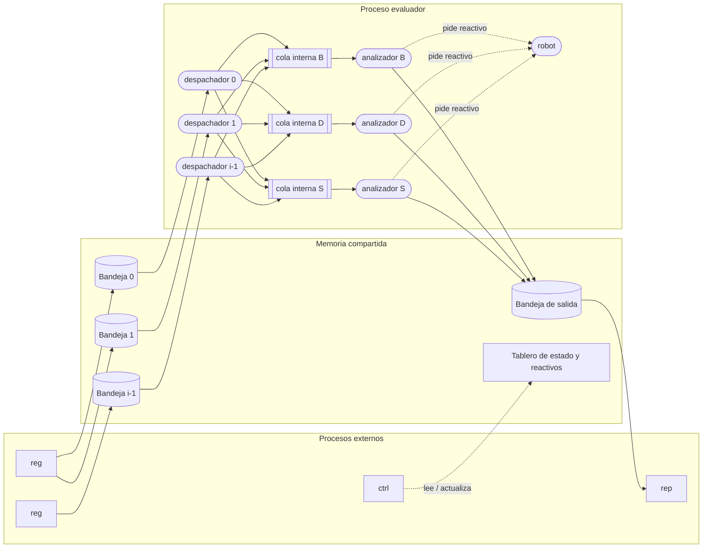

# Diseño del sistema evaluador de exámenes médicos

Práctica de Sistemas Operativos — Primera entrega
Fecha: 26 de octubre de 2026

## 1. Visión general

El sistema simula un laboratorio automatizado. Varios procesos de registro (`reg`) dejan muestras en un conjunto de bandejas de entrada. Un proceso evaluador (lo lanza `init`) toma esas muestras, las clasifica por tipo, las procesa en el analizador que corresponde y deja el resultado en una bandeja de salida. Desde ahí el proceso reportador (`rep`) las retira. El comando `ctrl` permite consultar el estado del sistema y recargar reactivos.

Toda la comunicación entre procesos pasa por **un único segmento de memoria compartida** y un conjunto de **semáforos con nombre**. Dentro del evaluador, la comunicación entre hilos usa mutex y variables de condición propias del proceso.



### Decisiones generales

| Aspecto | Decisión |
|---|---|
| Lenguaje | C (estándar C11) |
| Linux | `shm_open` + `mmap`, semáforos con nombre (`sem_open`), hilos `pthread` |
| Windows | `CreateFileMapping` + `MapViewOfFile`, semáforos con nombre (`CreateSemaphore`), hilos `CreateThread`, `CRITICAL_SECTION` y `CONDITION_VARIABLE` |
| Portabilidad | Una capa delgada (`plataforma.h`) con dos implementaciones: `plataforma_posix.c` y `plataforma_win.c`. El resto del código no sabe en qué sistema corre |
| Semáforos | Se usan **semáforos con nombre** en ambos sistemas. En Windows no se pueden guardar semáforos dentro de la memoria compartida, y en macOS los semáforos sin nombre no funcionan. Con nombre, el diseño queda igual en todas partes |
| Construcción | `Makefile` con objetivos `all`, `clean` e `install` (deja los binarios en `bin/`) |

## 2. Programas del sistema

La interfaz con el usuario es un solo programa, `evaluator`, que funciona como envoltorio (*wrapper*). Este programa no hace el trabajo: mira el primer argumento y ejecuta el programa real que corresponde.

| Programa | Lo invoca | Función |
|---|---|---|
| `evaluator` | el usuario | Envoltorio. Recibe `init`, `reg`, `ctrl` o `rep` y lanza el binario real |
| `evaluator-init` | `evaluator init` | Crea la memoria compartida y los semáforos, y luego ejecuta el evaluador (hilos) ocupando la consola |
| `evaluator-reg` | `evaluator reg` | Registra muestras desde ficheros o desde la entrada estándar |
| `evaluator-ctrl` | `evaluator ctrl` | Consola interactiva de consulta (`list`) y recarga de reactivos (`update`) |
| `evaluator-rep` | `evaluator rep` | Retira resultados de la bandeja de salida y los muestra |

### 2.1 Cómo encuentra el envoltorio a los programas reales

1. Si existe la variable de ambiente `EVALUATOR_BIN`, se busca `evaluator-<comando>` en ese directorio.
2. Si no existe, se busca en el mismo directorio donde está el ejecutable `evaluator`.
3. Si no se encuentra, el envoltorio imprime un error en `stderr` y termina con código 127.

En Linux el envoltorio usa `execv`, de modo que el programa real **reemplaza** al envoltorio. Por eso `init` queda ocupando la consola, como pide el enunciado. En Windows usa `CreateProcess`, espera a que el hijo termine y devuelve su mismo código de salida. Como el hijo comparte la consola, `Ctrl+C` le llega igual.

Si el comando no es uno de los cuatro válidos, se muestra la ayuda y el envoltorio termina con código 2.

### 2.2 Variables de ambiente

| Variable | Uso | Valor por omisión |
|---|---|---|
| `EVALUATOR_BIN` | Directorio donde están los programas reales | directorio del envoltorio |
| `EVALUATOR_NAME` | Nombre del segmento de memoria compartida cuando no se pasa `-n`/`-s` | `evaluator` |
| `EVALUATOR_SEED` | Semilla para los números aleatorios (tiempos y resultados). Permite repetir una corrida exacta durante las pruebas | tiempo actual |
| `EVALUATOR_SCALE` | Divide todos los tiempos de espera (procesamiento y robot). Con `10`, una muestra de 20 s tarda 2 s. Es solo para pruebas | `1` |

La línea de comandos siempre tiene prioridad sobre las variables de ambiente.

### 2.3 Códigos de salida comunes

| Código | Significado |
|---|---|
| 0 | Terminó bien |
| 1 | Error de ejecución (no se pudo crear o abrir la memoria, el sistema ya existe, etc.) |
| 2 | Error en los argumentos |
| 3 | El sistema no está iniciado (no existe el segmento indicado) |
| 127 | El envoltorio no encontró el programa real |

### 2.4 Nombre del segmento: `-n` y `-s`

El enunciado usa `-n` para el nombre del segmento en `init` y `reg`, pero `-s` en `ctrl` y `rep`. Además, en `init` la opción `-s` es el nivel de reactivo de piel. Para no romper ninguno de los dos casos:

- En `init`, `-n` es el nombre y `-s` es el reactivo de piel (tal como dice el enunciado).
- En `reg`, `ctrl` y `rep` se aceptan **tanto `-n` como `-s`** para el nombre.

El nombre se limita a 16 caracteres (letras, números, `_` y `-`), porque se usa como prefijo de los semáforos y algunos sistemas limitan esos nombres a 31 caracteres.

## 3. Comandos

### 3.1 `evaluator init`

```
evaluator init [-i <entradas>] [-ie <tam_entrada>] [-oe <tam_salida>]
               [-n <nombre>] [-b <reactivo_B>] [-d <reactivo_D>]
               [-s <reactivo_S>] [-q <tam_interna>] [-ee <cap_robot>]
```

| Opción | Significado | Por omisión | Rango válido |
|---|---|---|---|
| `-i` | número de bandejas de entrada | 5 | 1 … 32 |
| `-ie` | posiciones en cada bandeja de entrada | 6 | 1 … 1024 |
| `-oe` | posiciones en la bandeja de salida | 10 | 1 … 4096 |
| `-n` | nombre del segmento | `evaluator` | ver 2.4 |
| `-b` | nivel inicial de reactivo de sangre | 100 | 0 … 100 |
| `-d` | nivel inicial de reactivo de detritos | 100 | 0 … 100 |
| `-s` | nivel inicial de reactivo de piel | 100 | 0 … 100 |
| `-q` | tamaño de cada cola interna | 6 | 1 … 1024 |
| `-ee` | capacidad del robot (unidades de reactivo por viaje) | 50 | 1 … 100 |

> **Decisión de diseño:** `-ee` aparece en la sinopsis pero el enunciado no lo explica. A la vez, el enunciado dice que el robot lleva "una cantidad determinada" de reactivo, pero no da ningún parámetro para esa cantidad. Por eso `-ee` se usa como esa capacidad.

**Funcionamiento interno:**

1. Lee y valida los argumentos. Si alguno es inválido, imprime el error y termina con código 2.
2. Intenta abrir el segmento `<nombre>`:
   - Si existe, tiene el número mágico correcto y el proceso `pid_evaluador` sigue vivo, el sistema ya está corriendo: imprime un aviso y termina con código 1.
   - Si existe pero el evaluador ya no está vivo (quedó de una ejecución que terminó mal), lo borra junto con sus semáforos y sigue.
3. Calcula el tamaño total del segmento (sección 4.4), lo crea y lo pone en ceros.
4. Llena la cabecera, inicializa las colas (inicio, fin y cuenta en 0) y los niveles de reactivo.
5. Crea todos los semáforos con nombre con su valor inicial (sección 5.1).
6. Escribe `activo = 1` al final, cuando todo está listo. Los otros comandos revisan este campo antes de usar el sistema.
7. Instala el manejador de `SIGINT`/`SIGTERM` (en Windows, `SetConsoleCtrlHandler`).
8. Arranca los hilos del evaluador (sección 6) y se queda esperando a que terminen.
9. Al recibir la señal de terminar, hace el apagado ordenado (sección 6.6), libera los semáforos y borra el segmento.

### 3.2 `evaluator reg`

```
evaluator reg [-n <nombre>] { <fichero> ... | - }
```

Cada línea, venga de un fichero o de la entrada estándar, tiene el formato:

```
<bandeja> {B|D|S} <cantidad>
```

- `bandeja`: entero de `0` a `i-1`.
- tipo: `B` (Blood, sangre), `D` (Detritus, detritos) o `S` (Skin, piel). Se aceptan también en minúscula.
- `cantidad`: entero de `1` a `5`.
- Se ignoran las líneas vacías y las que empiezan por `#`, así los ficheros de ejemplo pueden tener comentarios.

**Modo interactivo (`-`):** lee de la entrada estándar hasta encontrar fin de fichero. Por cada muestra aceptada imprime su identificador en `stdout`, en una línea:

```
$ evaluator reg -
0 B 3
1
2 S 5
2
```

**Modo fichero:** procesa los ficheros en el orden en que se dieron. Un fichero que no existe se ignora sin mensaje, como pide el enunciado. Por cada fichero `nombre.ext` se crea `nombre.spl` en el mismo directorio, con una línea por muestra aceptada:

```
<id> <bandeja> <tipo> <cantidad>
```

**Líneas inválidas:** no se registran. Se escribe un aviso en `stderr` con el número de línea (`muestras.txt:4: formato inválido`) y se sigue con la siguiente línea.

**Funcionamiento interno, por cada línea válida:**

1. Abre el segmento. Si no existe o `activo` es 0, termina con código 3.
2. `wait(e<k>.vacios)`: si la bandeja `k` está llena, el proceso se bloquea aquí hasta que el evaluador saque una muestra.
3. `wait(id)` → toma `siguiente_id`, lo incrementa → `post(id)`.
   El identificador se asigna justo antes de insertar. Así el orden de los identificadores coincide con el orden real de llegada.
4. `wait(e<k>.mutex)` → copia la muestra en `items[fin]`, avanza `fin` de forma circular e incrementa `cuenta` → `post(e<k>.mutex)`.
5. `post(e<k>.llenos)`: avisa al despachador de esa bandeja.
6. Imprime el identificador (modo interactivo) o lo escribe en el `.spl` (modo fichero).

Varias instancias de `reg` pueden correr al mismo tiempo: el mutex de cada bandeja y el de identificadores evitan que se pisen.

### 3.3 `evaluator ctrl`

```
evaluator ctrl [-s <nombre>]
```

Abre una consola interactiva con el indicador `> `. Termina al encontrar fin de fichero (`Ctrl+D` en Linux, `Ctrl+Z` + Enter en Windows).

#### Sub-comando `list`

```
> list [ processing | waiting | reported | reactive | all ]
```

Sin argumento equivale a `all`. Cada lista empieza con su título y los elementos van separados por espacios. Una lista vacía muestra solo el título.

```
> list processing
Processing:
[12 0 B 3 5] [9 2 S 4 17]

> list waiting
Waiting:
[15 1 D 2] [16 3 B 1] [17 0 B 5]

> list reported
Reported:
[3 0 B negative] [5 4 D positive] [6 1 S -]

> list reactive
Reactive:
[B 85] [D 100] [S 42]
```

| Lista | Formato | De dónde se lee |
|---|---|---|
| `processing` | `[id i k q p]`, con `p` = tiempo de procesamiento asignado en segundos | tablero (muestra actual de cada analizador) |
| `waiting` | `[id i k q]` | bandejas de entrada **y** colas internas (vía tablero), ordenadas por `id` |
| `reported` | `[id i k r]`, con `r` = `negative`, `positive` o `-` | bandeja de salida (resultados que `rep` todavía no retiró) |
| `reactive` | `[tipo nivel]` | cabecera |
| `all` | las cuatro anteriores, en ese orden | — |

El enunciado no define el formato de `reactive`; usamos el de la tabla.

**Funcionamiento interno de `list`:** toma una "foto" de cada estructura. Por cada bandeja de entrada hace `wait(e<k>.mutex)`, copia el contenido a memoria local y hace `post(e<k>.mutex)`. Lo mismo con `tablero` y con la salida. Imprime cuando ya soltó todos los mutex. Así `ctrl` nunca deja bloqueado al sistema mientras escribe en pantalla.

Como la foto se toma estructura por estructura, una muestra que va de paso entre dos estructuras puede no aparecer o aparecer dos veces en un `list all`. Se acepta porque `list` es solo informativo.

#### Sub-comando `update`

```
> update { B | D | S } <cantidad>
```

Suma `cantidad` (entero positivo) al reactivo indicado: `wait(reactivo)` → `nivel = min(100, nivel + cantidad)` → `post(reactivo)`. Responde con el nuevo nivel:

```
> update S 30
S 72
```

Si un analizador estaba esperando al robot por falta de ese reactivo, el robot lo nota al llegar y no hace falta despertarlo desde `ctrl` (ver 6.4).

Los comandos desconocidos o mal escritos muestran un aviso en `stderr` y la consola sigue.

### 3.4 `evaluator rep`

```
evaluator rep [-s <nombre>] { -i <segundos> | -m <cantidad> }
```

Debe darse exactamente una de las dos opciones.

- **`-i <segundos>`:** se queda escuchando la bandeja de salida durante ese tiempo. Cada resultado que aparece se retira y se imprime. Al cumplirse el tiempo, termina.
- **`-m <cantidad>`:** retira exactamente esa cantidad de resultados. Si no hay suficientes, espera hasta completarlos.

Salida, un resultado por línea:

```
[id i k r]
```

Con `r` = `P` (positivo), `N` (negativo) o `?` (no concluyente).

> El enunciado usa `positive/negative/-` en `ctrl` y `P/N/?` en `rep`. Respetamos los dos formatos. Internamente se guarda una sola letra (`P`, `N`, `?`) y solo cambia la forma de imprimirla.

**Funcionamiento interno, por cada resultado:**

1. `wait(s.llenos)`. En modo `-i` se usa una espera con tiempo límite (`sem_timedwait` en Linux, `WaitForSingleObject` con *timeout* en Windows), calculado contra la hora de finalización.
2. `wait(s.mutex)` → copia `items[inicio]`, avanza `inicio` y decrementa `cuenta` → `post(s.mutex)`.
3. `post(s.vacios)`: libera un lugar para los analizadores.
4. Imprime el resultado.

Varias instancias de `rep` pueden correr a la vez; cada resultado lo recibe una sola.

## 4. Estructuras en memoria compartida

### 4.1 La muestra

```c
#define TIPO_SANGRE   0   /* 'B' */
#define TIPO_DETRITOS 1   /* 'D' */
#define TIPO_PIEL     2   /* 'S' */

typedef struct {
    uint64_t id;          /* identificador único */
    int32_t  bandeja;     /* cola de entrada por donde llegó */
    int32_t  tipo;        /* TIPO_SANGRE, TIPO_DETRITOS o TIPO_PIEL */
    int32_t  cantidad;    /* 1..5, también es lo que gasta de reactivo */
    int32_t  t_proceso;   /* segundos; se asigna al empezar a analizarla */
    char     resultado;   /* 'P', 'N', '?' o 0 mientras no hay resultado */
    int64_t  llegada;     /* hora en que entró a la bandeja (epoch, segundos) */
} muestra_t;
```

### 4.2 Cola circular (bandejas de entrada y de salida)

Las bandejas de entrada y la de salida usan la misma estructura. Los elementos no van dentro de la estructura: van en otra parte del segmento y se ubican con un desplazamiento (*offset*) desde el inicio del segmento. Se usa un desplazamiento y no un puntero porque cada proceso puede mapear el segmento en una dirección distinta.

```c
typedef struct {
    int32_t  capacidad;   /* ie para las de entrada, oe para la salida */
    int32_t  inicio;      /* posición del próximo elemento a sacar */
    int32_t  fin;         /* posición donde se pone el próximo elemento */
    int32_t  cuenta;      /* elementos ocupados; solo para ctrl y validaciones */
    uint32_t desp_items;  /* offset del arreglo muestra_t[capacidad] */
} cola_t;
```

- Insertar: `items[fin] = m; fin = (fin + 1) % capacidad; cuenta++`
- Sacar: `m = items[inicio]; inicio = (inicio + 1) % capacidad; cuenta--`

`cuenta` no se usa para decidir si hay espacio, porque de eso se encargan los semáforos `vacios` y `llenos`. Se mantiene para que `ctrl` sepa cuántos elementos recorrer.

### 4.3 Cabecera y tablero

```c
#define MAGIA_EVAL 0x45564131u   /* "EVA1": marca que el segmento es nuestro */

typedef struct {
    uint32_t magia;
    int32_t  activo;          /* 1 mientras el sistema funciona */
    int32_t  pid_evaluador;   /* proceso de init, para saber si sigue vivo */
    char     nombre[17];

    /* configuración que dio init */
    int32_t  num_entradas;    /* -i  */
    int32_t  tam_entrada;     /* -ie */
    int32_t  tam_salida;      /* -oe */
    int32_t  tam_interna;     /* -q  */
    int32_t  cap_robot;       /* -ee */

    uint64_t siguiente_id;    /* protegido por el semáforo "id" */
    int32_t  reactivo[3];     /* niveles actuales; semáforo "reactivo" */

    uint32_t desp_entradas;   /* cola_t[num_entradas] */
    uint32_t desp_salida;     /* cola_t */
    uint32_t desp_tablero;    /* tablero_t */
} cabecera_t;
```

Las colas internas son privadas del evaluador (el enunciado lo exige), pero `ctrl` necesita mostrar lo que está esperando y procesándose. Para eso el evaluador mantiene un **tablero**: una copia de lo que hay en cada cola interna y en cada analizador. El tablero solo se usa para informar; el trabajo real se hace con las colas internas.

```c
typedef struct {
    int32_t   en_cola[3];         /* cuántas muestras hay en cada cola interna */
    uint32_t  desp_cola[3];       /* offset de muestra_t[tam_interna] por tipo */
    int32_t   ocupado[3];         /* 1 si el analizador tiene una muestra */
    muestra_t actual[3];          /* la muestra que procesa cada analizador */
    int32_t   esperando_robot[3]; /* 1 si el analizador está parado sin reactivo */
} tablero_t;
```

### 4.4 Distribución del segmento

```
+---------------------------+  desplazamiento 0
| cabecera_t                |
+---------------------------+  desp_entradas
| cola_t  x  i              |
+---------------------------+
| muestra_t x ie   (bandeja 0)
| muestra_t x ie   (bandeja 1)
| ...                       |
| muestra_t x ie   (bandeja i-1)
+---------------------------+  desp_salida
| cola_t                    |
| muestra_t x oe            |
+---------------------------+  desp_tablero
| tablero_t                 |
| muestra_t x q   (B)       |
| muestra_t x q   (D)       |
| muestra_t x q   (S)       |
+---------------------------+
```

Tamaño total, redondeando cada bloque a 8 bytes para mantener la alineación:

```
tam = sizeof(cabecera_t)
    + i * sizeof(cola_t) + i * ie * sizeof(muestra_t)
    + sizeof(cola_t) + oe * sizeof(muestra_t)
    + sizeof(tablero_t) + 3 * q * sizeof(muestra_t)
```

Con los valores por omisión (i=5, ie=6, oe=10, q=6) el segmento ocupa menos de 4 KB.

## 5. Concurrencia entre procesos

### 5.1 Semáforos con nombre

Todos llevan como prefijo el nombre del segmento. En Linux el nombre es `/<nombre>.<sufijo>` y en Windows es `Local\<nombre>.<sufijo>`. Para el segmento `evaluator` y la bandeja 2, por ejemplo, el mutex queda como `/evaluator.e2.mutex`.

| Semáforo | Valor inicial | Protege / cuenta | Hace `wait` | Hace `post` |
|---|---|---|---|---|
| `id` | 1 | `siguiente_id` | `reg` | `reg` |
| `e<k>.mutex` | 1 | campos de la bandeja `k` | `reg`, despachador `k`, `ctrl` | los mismos |
| `e<k>.vacios` | `ie` | lugares libres en la bandeja `k` | `reg` | despachador `k` |
| `e<k>.llenos` | 0 | muestras en la bandeja `k` | despachador `k` | `reg` |
| `s.mutex` | 1 | campos de la bandeja de salida | analizadores, `rep`, `ctrl` | los mismos |
| `s.vacios` | `oe` | lugares libres en la salida | analizadores | `rep` |
| `s.llenos` | 0 | resultados en la salida | `rep` | analizadores |
| `reactivo` | 1 | `reactivo[3]` | analizadores, robot, `ctrl update` | los mismos |
| `tablero` | 1 | todo el `tablero_t` | analizadores, despachadores, `ctrl` | los mismos |

Con los valores por omisión son `1 + 5×3 + 3 + 2 = 21` semáforos.

### 5.2 Productor–consumidor en las bandejas

Cada bandeja de entrada es un búfer acotado clásico:

```
Productor (reg)                 Consumidor (despachador k)
---------------                 --------------------------
wait(e_k.vacios)                wait(e_k.llenos)
wait(e_k.mutex)                 wait(e_k.mutex)
   insertar                        sacar
post(e_k.mutex)                 post(e_k.mutex)
post(e_k.llenos)                post(e_k.vacios)
```

La bandeja de salida sigue el mismo esquema: los analizadores son los productores y `rep` es el consumidor.

### 5.3 Orden fijo de los cerrojos

Para que no haya interbloqueos, ningún hilo ni proceso toma dos mutex a la vez, salvo en estas combinaciones, que siempre se toman en este orden:

1. `e<k>.mutex` o `s.mutex`
2. `tablero`
3. `reactivo`

`ctrl` nunca toma dos a la vez: toma uno, copia y lo suelta.

## 6. El proceso evaluador

El evaluador es el mismo proceso de `init`. Arranca estos hilos:

| Hilos | Cantidad | Función |
|---|---|---|
| despachador | `i` (uno por bandeja) | saca muestras de su bandeja y las pone en la cola interna del tipo correcto |
| analizador | 3 (uno por tipo) | saca muestras de su cola interna, gasta reactivo, "procesa" y deja el resultado en la salida |
| robot | 1 | lleva reactivo del almacén a los analizadores que lo piden |

### 6.1 Colas internas

Hay una por tipo, de tamaño `q`. Viven en la memoria normal del proceso (no en el segmento compartido) y las comparten solo los hilos. Cada una es un búfer circular protegido con un mutex y dos variables de condición:

```c
typedef struct {
    muestra_t *items;
    int        capacidad, inicio, fin, cuenta;
    uint64_t   turno_siguiente;  /* próximo número que se reparte */
    uint64_t   turno_actual;     /* número al que le toca insertar */
    mutex_t    mutex;
    cond_t     hay_espacio;
    cond_t     hay_muestras;
} cola_interna_t;
```

`turno_siguiente` y `turno_actual` funcionan como los turnos de una fila en un banco. Cuando la cola está llena y varios despachadores quieren insertar, entran en el orden en que llegaron. Así ningún despachador se queda esperando indefinidamente mientras los demás se le adelantan.

### 6.2 Hilo despachador `k`

```
mientras activo:
    wait(e_k.llenos)
    si !activo: salir
    wait(e_k.mutex); m = sacar(bandeja k); post(e_k.mutex)
    post(e_k.vacios)

    c = cola_interna[m.tipo]
    lock(c.mutex)
    mi_turno = c.turno_siguiente++
    mientras c.cuenta == c.capacidad o mi_turno != c.turno_actual:
        wait(c.hay_espacio)
    insertar(c, m); c.turno_actual++
    broadcast(c.hay_espacio)      /* despierta al siguiente turno */
    signal(c.hay_muestras)
    unlock(c.mutex)

    actualizar tablero (en_cola y copia de la muestra)
```

**Bloqueo en cabeza de fila:** si la cola interna de piel está llena, el despachador de la bandeja 2 se queda esperando con esa muestra de piel aunque detrás venga una de sangre. Se acepta a propósito: mantiene el orden de llegada dentro de cada bandeja y es más fácil de verificar. El bloqueo dura como máximo lo que tarda el analizador de piel en sacar una muestra.

### 6.3 Hilo analizador del tipo `t`

```
mientras activo:
    lock(c.mutex)
    mientras c.cuenta == 0 y activo: wait(c.hay_muestras)
    m = sacar(c)
    broadcast(c.hay_espacio)
    unlock(c.mutex)

    /* asegurar reactivo: revisar y descontar en un solo paso */
    repetir:
        wait(reactivo)
        si reactivo[t] >= m.cantidad:
            reactivo[t] -= m.cantidad; listo = sí
        post(reactivo)
        si no listo: pedir_robot(t)   /* se bloquea hasta que el robot termine */
    hasta listo

    m.t_proceso = aleatorio(min[t], max[t])
    marcar en tablero: ocupado[t] = 1, actual[t] = m
    dormir(m.t_proceso / ESCALA)
    m.resultado = sortear_resultado()
    marcar en tablero: ocupado[t] = 0

    wait(s.vacios)                    /* si la salida está llena, espera */
    wait(s.mutex); insertar(salida, m); post(s.mutex)
    post(s.llenos)
```

**Tiempos de procesamiento** (segundos, uniforme entre los límites):

| Tipo | Mínimo | Máximo |
|---|---|---|
| B | 1 | 7 |
| D | 5 | 20 |
| S | 8 | 25 |

**Resultados:**

| Resultado | Probabilidad |
|---|---|
| `P` positivo | 50 % |
| `N` negativo | 35 % |
| `?` no concluyente | 15 % |

Se toma un número entre 0 y 99: de 0 a 49 es `P`, de 50 a 84 es `N` y de 85 a 99 es `?`.

> El enunciado dice que se escogen "homogéneamente", pero da porcentajes distintos. Usamos los porcentajes.

**Consumo de reactivo:** cada muestra gasta tantas unidades como su `cantidad` (1 a 5). Como el reactivo se revisa y se descuenta dentro del mismo `wait(reactivo)`, el nivel nunca queda negativo.

Cada hilo usa su propio generador aleatorio (`rand_r` con semilla propia, derivada de `EVALUATOR_SEED`), para que los hilos no compitan por un generador compartido.

### 6.4 Hilo robot

Hay un solo robot. Las solicitudes van a una pequeña fila interna (máximo 3, una por tipo; un analizador no puede pedir dos veces a la vez porque se queda bloqueado esperando).

```
pedir_robot(t):                       /* lo llama el analizador t */
    lock(robot.mutex)
    agregar t a robot.solicitudes
    marcar en tablero esperando_robot[t] = 1
    signal(robot.hay_solicitud)
    mientras !robot.terminado[t]: wait(robot.listo[t])
    robot.terminado[t] = 0
    unlock(robot.mutex)
    marcar en tablero esperando_robot[t] = 0

hilo robot:
    mientras activo:
        esperar una solicitud t (en orden de llegada)
        dormir(TIEMPO_VIAJE / ESCALA)      /* va al almacén y vuelve: 3 s */
        wait(reactivo)
        reactivo[t] = min(100, reactivo[t] + cap_robot)
        post(reactivo)
        dormir(TIEMPO_CARGA / ESCALA)      /* carga en el analizador: 1 s */
        terminado[t] = 1; signal(listo[t])
```

- Mientras el robot carga, el analizador sigue bloqueado dentro de `pedir_robot`, así que no procesa nada, como exige el enunciado.
- Si con un viaje no alcanza (por ejemplo, `cap_robot` es menor que la cantidad de la muestra), el analizador vuelve a revisar y pide otro viaje.
- Si mientras tanto alguien hizo `ctrl update`, el analizador lo nota al revisar de nuevo y sigue sin necesidad de otro viaje.
- Como el robot atiende en orden de llegada y hay como mucho tres solicitudes, ninguna espera más de tres viajes.

### 6.5 Por qué ninguna muestra espera para siempre

El enunciado pide que una muestra no quede en espera indefinidamente. El diseño lo garantiza así:

1. **Bandeja de entrada:** cada bandeja tiene su propio despachador, que saca en orden FIFO. Una muestra avanza siempre que el despachador avance.
2. **Cola interna:** el despachador entra por turnos (6.1), así que espera como mucho a los despachadores que llegaron antes que él. El analizador saca en orden FIFO.
3. **Analizador:** solo puede detenerse por falta de reactivo, y el robot siempre termina recargando (6.4). El tiempo de procesamiento tiene un máximo de 25 s.
4. **Salida:** el analizador solo se detiene si la salida está llena. Ese es el único punto que depende del usuario: si nadie ejecuta `rep`, el sistema se va llenando hasta detenerse. Esto es intencional, porque es lo que pide el enunciado: no añadir más de lo que cabe en la salida.

Con lo anterior, la "prioridad" de una muestra es su orden de llegada dentro de su tipo, que coincide con el orden de su identificador.

> **Limitación conocida:** los semáforos de POSIX y de Windows no garantizan que despierten en orden de llegada. Si varios procesos `reg` esperan a la vez por la misma bandeja llena, cualquiera puede entrar primero. En la práctica todos terminan entrando, porque el despachador vacía la bandeja constantemente.

### 6.6 Apagado ordenado

Al recibir `Ctrl+C` (o `SIGTERM`):

1. El manejador solo pone `activo = 0` (no hace más trabajo, para ser seguro dentro de una señal).
2. El hilo principal lo detecta y despierta a todos los que pueden estar bloqueados:
   - `post(e<k>.llenos)` una vez por despachador.
   - `post(e<k>.vacios)` `ie` veces por bandeja, para soltar procesos `reg` que estén esperando. `reg` ve `activo = 0` y termina con código 3.
   - `broadcast` a todas las variables de condición internas y del robot.
   - `post(s.vacios)` tres veces, por si algún analizador espera la salida.
3. Espera a que terminen todos los hilos (`join`).
4. Cierra y borra los semáforos y el segmento (`sem_unlink`, `shm_unlink`; en Windows, cerrar los *handles* basta para que el sistema los libere).

Las muestras que no se alcanzaron a procesar se pierden. Se avisa en `stderr` cuántas quedaron.

## 7. Organización del código

```
evaluador/
|-- Makefile
|-- Readme.md
|-- Install.md
|-- src/
|   |-- evaluator.c          envoltorio
|   |-- init.c               init + arranque de hilos
|   |-- despachador.c
|   |-- analizador.c
|   |-- robot.c
|   |-- reg.c
|   |-- ctrl.c
|   |-- rep.c
|   |-- memoria.c / .h       crear, abrir y ubicar estructuras en el segmento
|   |-- cola.c / .h          cola circular (compartida e interna)
|   |-- args.c / .h          lectura de opciones
|   |-- plataforma.h         interfaz común de SO
|   |-- plataforma_posix.c
|   +-- plataforma_win.c
|-- bin/                     (no se sube al repositorio)
|-- doc/
|   +-- diseno.md            este documento
+-- examples/
    |-- muestras1.txt
    |-- muestras_invalidas.txt
    +-- carga_alta.txt
```

`plataforma.h` ofrece solo lo que el resto del código necesita: crear/abrir/borrar la memoria compartida, crear/abrir/esperar/liberar semáforos con nombre (con y sin tiempo límite), hilos, mutex, variables de condición, dormir y obtener el pid. El `Makefile` compila `plataforma_posix.c` o `plataforma_win.c` según el sistema.

### 7.1 Compilación en Linux y Windows

El mismo código fuente se compila en los dos sistemas. Lo único que cambia es qué archivo de plataforma entra en la compilación y con qué bibliotecas se enlaza.

| | Linux | Windows |
|---|---|---|
| Compilador | `gcc` o `clang` | `gcc` de MinGW-w64 (instalado con MSYS2) |
| Herramienta | `make` | `make` de MSYS2 (`mingw32-make`) |
| Archivo de plataforma | `plataforma_posix.c` | `plataforma_win.c` |
| Bibliotecas | `-pthread`, `-lrt` | ninguna extra (la API de Windows viene con MinGW) |
| Binarios | `bin/evaluator`, `bin/evaluator-init`, … | `bin\evaluator.exe`, `bin\evaluator-init.exe`, … |

El `Makefile` detecta el sistema así:

```make
ifeq ($(OS),Windows_NT)
    PLATAFORMA = src/plataforma_win.c
    EXT        = .exe
    LIBS       =
else
    PLATAFORMA = src/plataforma_posix.c
    EXT        =
    LIBS       = -pthread -lrt
endif
```

En Windows la variable de ambiente `OS` siempre vale `Windows_NT`, así que no hay que pasar ninguna opción a mano.

**Pasos para compilar:**

- Linux: `make` dentro de `evaluador/`.
- Windows: instalar MSYS2, abrir la terminal "MSYS2 MINGW64", instalar el compilador con `pacman -S mingw-w64-x86_64-gcc make` y luego `make` dentro de `evaluador/`.

**Detalles propios de cada sistema que ya están contemplados en el diseño:**

| Tema | Linux | Windows | Sección |
|---|---|---|---|
| Lanzar el programa real | `execv` | `CreateProcess` y esperar al hijo | 2.1 |
| Nombre de los semáforos | `/<nombre>.<sufijo>` | `Local\<nombre>.<sufijo>` | 5.1 |
| Fin de fichero en `ctrl` y `reg -` | `Ctrl+D` | `Ctrl+Z` + Enter | 3.3 |
| Espera con tiempo límite en `rep -i` | `sem_timedwait` | `WaitForSingleObject` | 3.4 |
| Terminar con `Ctrl+C` | `SIGINT` / `SIGTERM` | `SetConsoleCtrlHandler` | 6.6 |
| Saber si el evaluador sigue vivo | `kill(pid, 0)` | `OpenProcess` + `GetExitCodeProcess` | 3.1 |
| Generador aleatorio por hilo | `rand_r` | función propia sencilla (Windows no trae `rand_r`) | 6.3 |
| Borrar recursos al terminar | `sem_unlink`, `shm_unlink` | se liberan solos al cerrar el último *handle* | 6.6 |

En Windows, si `init` termina mal, los recursos desaparecen solos cuando se cierra el proceso. En Linux pueden quedar en `/dev/shm`; por eso `init` revisa y limpia restos de una ejecución anterior (3.1, paso 2).

El `Install.md` explica cómo instalar los binarios en otro directorio en cada sistema.

## 8. Plan de pruebas

| Prueba | Qué se verifica |
|---|---|
| `init` dos veces con el mismo nombre | el segundo avisa y no destruye al primero |
| `reg` con un fichero inexistente | se ignora sin mensaje |
| `reg` con líneas inválidas | aviso por línea, el resto se registra, el `.spl` solo trae las válidas |
| varios `reg` en paralelo | todos los identificadores son únicos y no se pierden muestras |
| `-ie 1` y muchas muestras | `reg` se bloquea y continúa cuando hay espacio |
| `-oe 1` sin ejecutar `rep` | el sistema se detiene sin errores; con `rep -m` se reanuda |
| reactivo inicial en 0 | el robot recarga y las muestras salen igual |
| `ctrl update` mientras el robot va en camino | el analizador continúa sin esperar otro viaje |
| `rep -i 5` sin muestras | termina a los 5 s sin imprimir nada |
| `Ctrl+C` con `reg` bloqueados | todos terminan y no queda nada en `/dev/shm` |
| `EVALUATOR_SEED` fijo | dos corridas dan los mismos tiempos y resultados |
